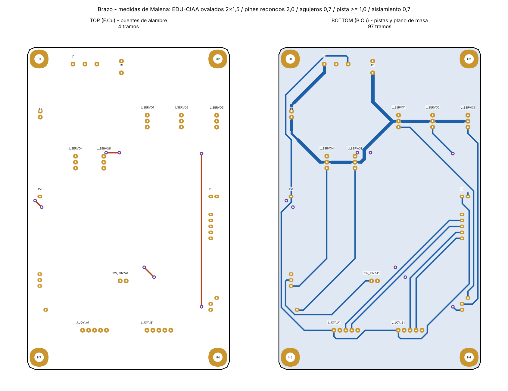

# PCB del brazo — corrección del 2.º informe de avance

Grupo N.º 3. Respuesta a la devolución de Malena (24-11-2026) sobre `brazo.kicad_pcb`.
La versión entregada está en el historial de git (commit `Informe_avance_2`).

## Norma de diseño

Como no teníamos el apunte de restricciones de la cátedra, se usaron las del proyecto
aprobado de referencia (`kicad-v2`), que es de la misma materia y del mismo proceso
de fabricación. Quedaron cargadas en `brazo.kicad_pro`, así que el DRC las controla.

| | antes | ahora |
|---|---|---|
| aislamiento mínimo | 0,0 mm (el DRC no controlaba) | **0,7 mm** |
| pista de señal (clase `Default`) | 0,7 mm | **1,0 mm** |
| pista de potencia (clase `Potencia`: `+5V` y entrada al fusible) | 0,7 mm | **1,7 a 2,5 mm** |
| cobre al borde | 0,5 mm | 0,5 mm |
| vía | 1,5 / 0,7 mm | 1,5 / 0,7 mm |

## Las tres observaciones

**1. Capas invertidas.** Todo el ruteo está en B.Cu, la cara que se ataca. En F.Cu
sólo hay puentes de alambre: tramos rectos de un agujero a otro.

**2. Pistas muy juntas.** El ruteo original se había hecho con pistas de 0,2 mm y
después se las ensanchó a 0,7 mm. Los tramos paralelos se pisaban y había 20
cortocircuitos entre pistas. Se quitaron las 65 islas de P1 y P2 que no se usan y la
placa se ruteó de nuevo entera con la norma de arriba.

**3. Pads ovalados.** Las islas de P1 y P2 eran de 2,0 × 1,7 y 2,2 × 1,7 mm, casi
redondas. Ahora son de **2,6 × 1,7 mm**, alargadas hacia el lado donde se quitaron
los pines: el cobre está corrido 0,3 mm respecto del agujero. F1 pasó a 2,6 × 1,8 mm,
porque con su perforación de 1,0 mm el anillo de cobre quedaba en 0,35 mm.

## Potencia

Los cinco servos piden hasta 4,74 A. Los tramos por donde pasa toda esa corriente
(bornera → fusible → J_SERVO4 → J_SERVO5) tienen 2,5 mm, que alcanza para 4,7 A con
10 °C de calentamiento (IPC-2221, cobre de 35 µm). Donde la pista entra a un pin de
servo, que está entre otros dos pines a 2,54 mm, queda un tramo corto de 1,7 mm.

## Puentes de alambre

| red | largo | motivo |
|---|---|---|
| PWM_HOMBRO | 61 mm | los tres PWM de los servos llegan cruzados a P1: uno tiene que cruzar |
| GND (×4) | 4 a 5 mm | unen pedazos del plano de masa por encima de una pista |

En una placa de una cara, cada pista corta el relleno de masa. Los cuatro puentes
cortos unen esos pedazos. El archivo entregado tenía 5 puentes, de 19 a 60 mm.

## Otros errores que se corrigieron

- El relleno de cobre estaba en la red **+3,3 V** en vez de GND.
- Faltaban la entrada de +5 V y el +3,3 V de la bornera nueva de 3 vías, y la masa
  llegaba al pad de +5 V.
- PWM_MUÑECA y JOY_B_Y no llegaban a sus pines de P2 y P1.

## Estado

DRC de KiCad: **0 errores, 0 pads sin conectar**. Quedan 16 advertencias esperables:

- 11 `lib_footprint_mismatch`: las huellas están modificadas a propósito. **No
  actualizarlas desde la biblioteca.**
- 5 `silk_over_copper`: las islas más grandes recortan un poco la serigrafía. Es
  cosmético.

## Para el aula virtual con Malena

1. ¿Las restricciones del apunte coinciden con las del proyecto aprobado
   (0,7 / 1,0 / 1,7 mm)?
2. Al sacar pines de P1 y P2 también se sacaron sus agujeros. ¿El conector de 2×20 se
   recorta, o prefiere que los agujeros queden sin cobre para que entre entero?
3. ¿Le parecen bien los cuatro puentes cortos de masa?
