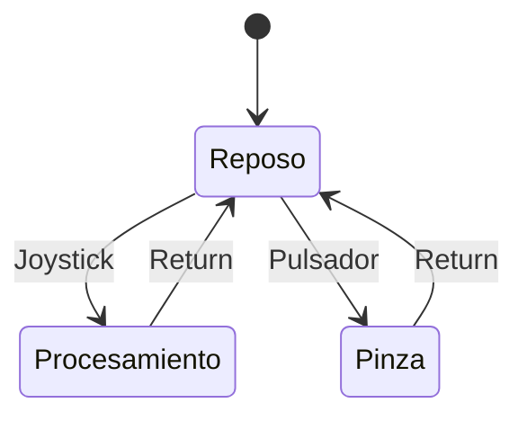

# Firmware del Brazon Robotico

El proyecto se desarrollará como firmware empotrado (bare-metal) sobre la placa EDU-CIAA-NXP. 
Para la gestión de tareas, la ejecución se estructurará mediante un superloop que evaluará una Máquina de Estados Finitos (MEF) con retardos no bloqueantes. La arquitectura del firmware se dividirá en cuatro capas de abstracción bien definidas:

## Capa de Abstraccion del Hardware (HAL)

Esta capa representa la frontera directa con el silicio y es la única que interactuará con los registros del microcontrolador LPC4337, utilizando para ello la biblioteca LPCOpen y las macros de la sAPI. Sus responsabilidades incluyen la configuración de la frecuencia del procesador ARM Cortex-M4, la inicialización de los canales del ADC de 10-bit para el muestreo de los potenciómetros, la configuración del periférico SCTimer (State Configurable Timer) para la generación de las cinco señales PWM a 50 Hz, y la definición de los pines GPIO como entradas o salidas.

## Capa de Control de Dispositivos (Drivers)

Este nivel dota de significado físico a las señales eléctricas gestionadas por la HAL, abstrayendo el comportamiento de los actuadores. El módulo ` servos.c` encapsulará los límites mecánicos de cada articulación para prevenir colisiones o sobreesfuerzos estructurales. Asimismo, implementará una función de mapeo lineal que traducirá un comando angular (ej. "90 grados") al ancho de pulso en microsegundos requerido por la capa inferior. Por su parte, el módulo `joystick.c` adquirirá el valor crudo del ADC, aplicará un filtro digital para mitigar el ruido eléctrico y establecerá una zona muerta por software para evitar movimientos parásitos, devolviendo finalmente un vector lógico de velocidad normalizado.

## Capa Logica (Middleware)

Constituye el núcleo de procesamiento matemático del sistema. Esta capa recibe los vectores lógicos de intención de movimiento provistos por el controlador del joystick e incrementa las variables angulares de las articulaciones principales. Inmediatamente, ejecuta el algoritmo trigonométrico que evalúa los ángulos resultantes del hombro y el codo, calculando los grados exactos de compensación que debe adoptar la muñeca para mantener la ortogonalidad de la pinza. Al operar exclusivamente con variables lógicas, esta capa se mantiene agnóstica respecto a la implementación física del hardware.

## Capa de Aplicacion (App)

Centralizada en el archivo principal `main.c`, esta capa aloja el despachador de tareas (superloop) y la lógica de estados del sistema (MEF). Su función es orquestar la ejecución temporal de los módulos inferiores utilizando el reloj de interrupción del sistema (SysTick). Mediante el uso de retardos no bloqueantes, se definen ventanas de tiempo específicas para tareas recurrentes, tales como la adquisición de datos (leerJoystick()), la actualización de la trigonometría (calcularMovimiento()) y el refresco de las salidas (actualizarPWM()), garantizando el determinismo del sistema sin necesidad de un sistema operativo en tiempo real.

## Diagrama de Estados de la MEF

# Estraegia de Control y Cinematica

El firmware implementa un enfoque de control híbrido diseñado específicamente para garantizar la manipulación segura de fluidos de laboratorio. 
Para comprender la arquitectura, definiremos los dos paradigmas de control clasicos:
- **Control Articular:** Consiste en el control individual de cada uno de los grados de libertad del brazo robotico. Cada eje fisico del Joystick incrementa o decrementa directamente el angulo de una articulacion especifica.
- **Control Cartesiano:** El usuario comanda desplazamientos espaciales en linea recta sobre los ejes Cartesianos (X, Y, Z). El microcontrolador ejecuta algoritmos de cinematica inversa para calcular simultaneamente la combinacion de angulos requerida en todos los motores para lograr ese movimiento recto.

### El caso especial de la muñeca

Manejar liquidos mediante control articular es una tarea sumamente complicada, ya que el movimiento del hombro y el codo generan trayectorias que inclinaran la muestra si la muñeca no compensa el movimiento de manera simultanea. Para solucionar esto el firmware condicionara el comportamiento de la muñeca al estado de la pinza:
- **Pinza Cerrada:** La muñeca actuara en modo **Cartesiano**. A partir de este instante, el microcontrolador lee la posición del hombro y el codo y calcula matemáticamente, en tiempo real, el ángulo de contra-rotación exacto que debe aplicar la muñeca. Esto garantiza que el tubo de ensayo se mantenga siempre bloqueado a 90 grados respecto a la base, independientemente de cómo se flexione el resto del brazo.
- **Pinza Abierta:** La muñeca actuara en modo **Articular**, permitiendo al usuario ajustar libremente el angulo de rotacion independientemente de la posicion cartesiana del brazo.